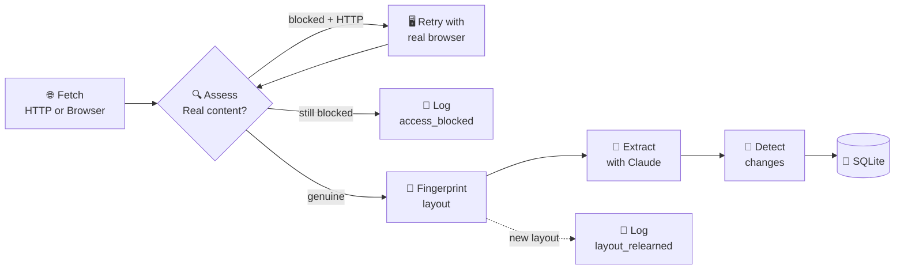
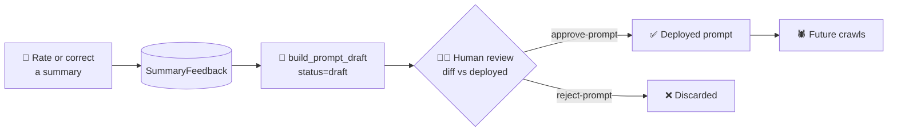

<div align="center">

# 🕷️ Self-Evolving Web Crawler Agent

**An AI agent that discovers regulatory websites, learns new page layouts, and extracts structured data, without hand-coding each site.**

[](https://www.python.org/)
[](https://langchain-ai.github.io/langgraph/)
[](https://www.anthropic.com/)
[](https://modelcontextprotocol.io)
[](https://streamlit.io/)
[](https://www.sqlite.org/)

[Quick Start](#-quick-start) · [How It Works](#-how-it-works) · [Self-Learning](#-self-learning) · [Dashboard](#-dashboard) · [MCP Server](#-mcp-server)

</div>

---

## ✨ Overview

Public regulatory sites (US Federal Register, UK Legislation, EU EUR-Lex) each look different, change often, and sometimes hide behind bot mitigation. This agent handles that without per-site code:

- 🧭 **Discovers** websites and adapts to country and regional domains
- 🧬 **Learns** new page layouts through structural DOM fingerprinting, and logs a *"learned new layout"* event instead of silently breaking
- 🛡️ **Detects bot-mitigation pages** (CAPTCHA, access denied, JS-only shells) and escalates to a real browser, or gives up and logs the crawl as blocked
- 🧠 **Extracts** structured regulation items with Claude (title, dates, status, summary)
- 🔮 **Deduces upcoming changes** such as proposed rules and future effective dates
- 💾 **Stores** everything in a local SQLite database

> **What "self-evolving" means here:** the agent notices when something changes and reacts, instead of quietly storing an empty crawl as if it succeeded. It also gets smarter from accumulated history. See [Self-Learning](#-self-learning).

---

## 🚀 Quick Start

```bash
python3 -m venv .venv
.venv/bin/pip install -e ".[dev,browser,ui]"
.venv/bin/crawl4ai-setup        # only for fetch_mode: browser (installs Playwright browser)
cp .env.example .env            # then set ANTHROPIC_API_KEY
```

```bash
.venv/bin/crawler-agent init-db
.venv/bin/crawler-agent crawl --site us_federal_register
.venv/bin/crawler-agent ui      # open the dashboard
```

<details>
<summary><b>📋 Full CLI reference</b></summary>

<br>

| Area | Command | What it does |
| --- | --- | --- |
| **Setup** | `init-db` | Create the local SQLite database |
| **Crawl** | `crawl --site <id>` / `crawl --all` | Crawl one site or every enabled site |
| **Inspect** | `list-upcoming --country US` | Show deduced upcoming changes |
| | `list-layout-events` | Show layout-learning history |
| **Discovery** | `revalidate-sites` | Re-probe seed URLs and self-correct broken ones |
| | `discover-site --country CA` | Propose a new country's regulatory site |
| | `list-pending-sites` | See proposals awaiting a decision |
| | `approve-site <id> --comment "..."` | Approve and register a proposed site |
| | `reject-site <id> --comment "..."` | Discard a proposed site |
| | `list-site-decisions` | Past approvals and rejections with reasons |
| **Feedback** | `list-feedback` | Raw summary feedback |
| | `review-prompt` | Diff of the draft prompt vs. the deployed one |
| | `approve-prompt <id> --comment "..."` | Deploy the draft prompt |
| | `reject-prompt <id> --comment "..."` | Discard the draft prompt |
| | `list-prompt-decisions` | Past prompt approvals and rejections |
| **Sites** | `add-site my_new_site.yaml` | Register a site from a YAML file |
| **Tools** | `ui` | Launch the Streamlit dashboard |
| | `mcp` | Start the MCP server |

</details>

<details>
<summary><b>➕ Add a new site without touching code</b></summary>

<br>

```bash
.venv/bin/crawler-agent add-site my_new_site.yaml
```

```yaml
# my_new_site.yaml
id: ca_gazette
name: Canada Gazette
country: CA
base_url: https://gazette.gc.ca
seed_urls:
  - https://gazette.gc.ca/rp-pr/p2/index-eng.html
fetch_mode: http   # or "browser" if the site requires real browser rendering
crawl_interval_hours: 24
```

</details>

---

## 🧩 How It Works

Each seed URL runs through a small **LangGraph** agent (`crawler_agent/agent/graph.py`) instead of a fixed fetch-then-extract pipeline.



| # | Step | Module | What happens |
| :-: | --- | --- | --- |
| 1 | **Fetch** 🌐 | `fetch/` | Polls via HTTP, or via `BrowserFetcher` (Crawl4AI on Playwright) for JS-rendered or bot-protected pages. `robots.txt` is honored with `protego` (RFC 9309) for both fetchers, and HTTP is rate-limited per domain. |
| 2 | **Assess** 🔍 | `agent/assess.py` | Claude judges whether the content is genuine or a bot-mitigation page. Real sites often return a 200/202 that looks fine but carries no data. |
| 3 | **Escalate or give up** 🛡️ | `agent/graph.py` | A blocked HTTP fetch retries once with a real browser. If still blocked, an `access_blocked` event is logged and the crawl moves on. |
| 4 | **Fingerprint** 🧬 | `layout/` | A structural signature of the DOM (tag/class skeleton, ignoring text), so content updates don't look like layout changes. A new fingerprint logs `layout_relearned`. |
| 5 | **Extract** 🧠 | `extraction/llm_extractor.py` | Cleaned page text goes to Claude with a forced structured-output tool call, returning regulation items. |
| 6 | **Detect changes** 🔔 | `change_detection/detector.py` | Items are classed as new, updated, or unchanged. Future effective dates and `proposed`/`upcoming` statuses become deduced upcoming changes. |
| 7 | **Store** 💾 | `db/models.py` | Sites, layout versions, page snapshots, regulation items, and a change-event log. |

### 🌍 Per-site fetch strategy

*Discovered by testing against the real sites.*

| Site | Strategy |
| --- | --- |
| 🇺🇸 **US Federal Register** | `robots.txt` disallows the HTML search pages, and the access-denied page points automated tools to the public JSON API. The registry uses the sanctioned `/api/v1/documents.json` endpoint, with no key required. |
| 🇬🇧 **UK Legislation** | CDN-level bot mitigation returns an empty `202` to plain HTTP. A headless browser renders the real page, so it uses `fetch_mode: browser`. |
| 🇪🇺 **EU EUR-Lex** | **Currently `enabled: false`** (as of 2026-11-14). Its `robots.txt` now returns `User-agent: *` / `Disallow: /`, a site-wide block. This project never crawls past an explicit disallow. The config is kept, and `revalidate-sites` re-enables the site automatically if its probe succeeds again. |

<details>
<summary><b>🧹 Content cleaning and markdown</b></summary>

<br>

`BrowserFetcher` uses Crawl4AI, which can optionally prune a page's HTML down to dense-content markdown before extraction. That filter is a density heuristic and is **not enabled by default** (`select_markdown` in `fetch/browser_fetcher.py`). Tested on two real EUR-Lex pages, it kept the real rows on a daily-issue listing but discarded them on an index page, keeping denser but irrelevant "about this site" prose instead. Enabling it for a site needs extraction-quality verification on that site's actual pages.

By default, every browser-fetched page goes through `utils/html_clean.to_text()`, the same deterministic cleaner used for HTTP-fetched pages.

</details>

<details>
<summary><b>⚠️ Known limitations</b></summary>

<br>

LLM extraction is not perfectly deterministic. Change detection hashes only material fields (title, status, dates, document type/number), not the free-text summary, and normalizes trailing punctuation on titles, so harmless variance isn't logged as a false "updated" event.

- ✅ US Federal Register and UK Legislation: verified stable (zero false updates) across repeated crawls
- 🟡 EU: close (19/20 items stable on a real run). One ambiguous "Decision" entry with no clean machine-readable status still occasionally flickers between `enacted` and `unknown`.

</details>

---

## 🧠 Self-Learning

Two mechanisms change the agent's behavior over time from accumulated history, not just within a single crawl.

> 🔐 **Human approval is always required.** Both mechanisms are two-step: an automatic step *proposes* a change, and a separate human-gated step *deploys* it. Discovery never registers a site on its own, and feedback never changes a live prompt on its own.

### 1️⃣ Site discovery and self-correction

`crawler_agent/discovery/`

| Command | Behavior |
| --- | --- |
| `discover-site --country CA` | Claude suggests candidate gazette URLs (`candidate_suggester.py`, knowledge-sourced, no web search). Each is checked against a **hard domain allowlist** (`authentic_domains.py`), so non-`.gov`-style domains are never even fetched. A candidate that extracts real content becomes a **pending `SiteProposal`**, not a registry write. |
| `list-pending-sites` | Shows proposals awaiting a decision. |
| `approve-site <id>` | The **only** path that calls `sites/loader.append_site()` to register a site. |
| `reject-site <id>` | Discards the proposal. Both take `--comment`. |
| `revalidate-sites` | Re-probes every registered seed URL through the real fetch → assess → extract pipeline and self-corrects broken ones, via a site's dynamic resolver or generic fallback URL patterns. Automatic, but only acts on sites a human already approved. |

> ✅ **Verified live:** Canada Gazette candidates all passed the domain gate, but every specific path returned 404. The tool reported failure and proposed nothing, instead of guessing.

**Dynamic seed resolvers** (`discovery/resolver.py`): some sites keep real content behind a hub page that changes daily. A site can declare `seed_resolver: eurlex_latest_oj` instead of a fixed URL, and `pipeline/run.py` resolves it fresh on every crawl. That took EU extraction from 4 ambiguous items to 20 real ones, before EUR-Lex's `robots.txt` later blocked all automated access. The resolver is kept as-is in case that changes back.

### 2️⃣ Summaries that improve from user feedback

`crawler_agent/feedback/`



- In the dashboard's item view, rate a summary **Helpful / Not helpful** or submit a corrected rewrite.
- `recent_feedback_examples()` surfaces the most useful rows: explicit before/after corrections, or "not helpful" ratings with a comment.
- `build_prompt_draft()` computes what the system prompt *would* become and holds it as a `PromptVersion` with `status="draft"`. View it with `review-prompt` (a unified diff) or the dashboard's **Prompt Review** tab.
- Only `approve-prompt <id>` marks it `approved`. `get_deployed_system_prompt()`, which real crawls use, reads only the latest *approved* version and falls back to the base prompt otherwise.

> **Honest limits of both:** candidate suggestion can still be wrong, so discovery never trusts a suggestion without an empirical probe. Fallback URL patterns are best-effort heuristics observed on real sites. Feedback-driven prompt changes are only as good as the model's ability to generalize from a handful of examples. Approval gates *whether* to deploy a change, not whether the change is well-judged.

---

## 📊 Dashboard

```bash
.venv/bin/crawler-agent ui
```

A local **Streamlit** dashboard (`src/crawler_agent/ui/app.py`) at `http://localhost:8501`, reading directly from the same SQLite database the CLI writes to.

| Tab | Shows |
| --- | --- |
| 🏠 **Overview** | Counts per site |
| 🔮 **Upcoming changes** | Deduced proposed rules and future effective dates |
| 📚 **Regulation items** | All tracked items, filterable by country, site, and status, with search |
| 🧬 **Layout history** | Layout-learning events |
| 📜 **Change log** | The full change-event log |
| 🌍 **Site Discovery** | Approve or reject pending site proposals |
| ✍️ **Prompt Review** | Approve or reject the pending feedback-driven prompt draft |

Run a crawl, then click **Refresh data** in the sidebar to see new results.

---

## 🔌 MCP Server

```bash
.venv/bin/pip install -e ".[mcp]"
.venv/bin/crawler-agent mcp
```

Exposes the crawled data over [MCP](https://modelcontextprotocol.io) (stdio), so any client, such as Claude Desktop, Claude Code, or another agent, can query it directly. `src/crawler_agent/mcp_server.py` defines six tools:

| Tool | Purpose |
| --- | --- |
| `list_regulation_items` | Filter by country, site, status, or title search |
| `get_regulation_item` | Fetch one item |
| `list_upcoming_changes` | Deduced upcoming changes |
| `list_sites` | Registered sites |
| `list_layout_events` | Layout-learning history |
| `list_change_events` | Change-event log |

> 🔒 **Read-only, deliberately.** There is no write or approval tool. `discover-site`, `approve-site`/`reject-site`, and `approve-prompt`/`reject-prompt` are not reachable through MCP. Exposing them would let any connected client bypass the human-approval gate they exist to enforce.

<details>
<summary><b>🖥️ Claude Desktop config</b></summary>

<br>

Add to `claude_desktop_config.json`:

```json
{
  "mcpServers": {
    "regulatory-crawler": {
      "command": "/absolute/path/to/.venv/bin/crawler-agent",
      "args": ["mcp"]
    }
  }
}
```

</details>

---

## 🧪 Tests

```bash
.venv/bin/pytest
```

Fingerprinting, change detection, and the agent's fetch/assess/escalate routing are tested with local fixtures and fakes, so **no network or LLM calls are required**.

---

<div align="center">

Built with 🐍 Python, 🦜 LangGraph, and 🤖 Claude

</div>
